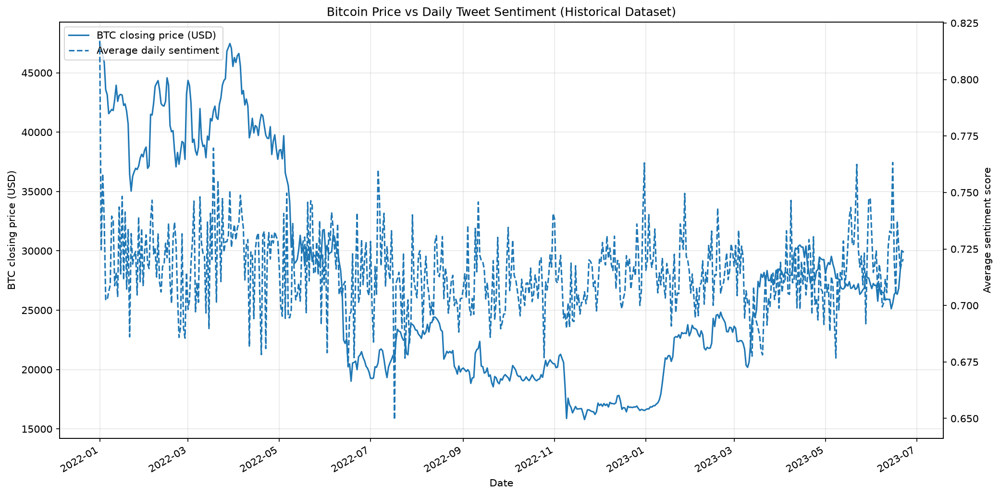

cd ~/Documents/btc-sentiment-agent

cat > evaluation_report.md <<'EOF'
# Bitcoin Sentiment–Price Prediction Agent
## Evaluation Report

**Project:** CrowdWisdomTrading X Sentiment Price Prediction Agent  
**Asset:** Bitcoin (BTC)  
**Date:** 23 October 2026  
**Status:** Preliminary evaluation

## 1. Executive Summary

This project investigates whether social-media sentiment and Bitcoin market data can help predict the next day's closing price. A Random Forest regressor was evaluated using walk-forward validation and compared with a naive baseline that predicts the next closing price using the current closing price.

The Random Forest did not outperform the naive baseline. Its walk-forward MAE was $598.63 compared with $404.38 for the baseline, while its RMSE was $789.32 compared with $591.72.

The results are reported transparently. The model has not demonstrated superior forecasting performance over the simple baseline.

## 2. Project Objectives

- Process historical Bitcoin-related tweet sentiment.
- Combine sentiment features with historical Bitcoin prices.
- Engineer features for machine-learning prediction.
- Train a Random Forest regression model.
- Evaluate the model using walk-forward validation.
- Visualize historical sentiment and price movements.
- Evaluate preliminary trading-strategy risk metrics.

## 3. Dataset Description

The existing sentiment dataset contains Bitcoin-related tweets from 1 January 2022 to 22 June 2023. It includes tweet text, dates, sentiment labels and scores, and engagement information.

Historical Bitcoin price data was aligned with daily sentiment features to build the training dataset.

**Important limitation:** This dataset does not cover the latest 180 days of X posts. Recent X-post collection and relevant news integration remain incomplete. Therefore, this report does not claim to represent current social sentiment.

## 4. Features and Methodology

The current model uses the following features:

- Bitcoin closing price
- Trading volume
- Daily tweet count
- Average sentiment score
- Aggregated likes and reposts
- Negative, neutral, and positive sentiment counts
- One-day and three-day returns

The target variable is the next-day closing price (`target_next_day`).

The workflow includes daily sentiment aggregation, price-data alignment, feature engineering, Random Forest training, and expanding-window walk-forward validation.

The walk-forward evaluation produced 214 out-of-sample predictions.

## 5. Model Evaluation

### Walk-forward validation

| Metric | Random Forest | Naive Baseline |
|---|---:|---:|
| MAE | $598.63 | $404.38 |
| RMSE | $789.32 | $591.72 |

Lower MAE and RMSE values indicate better predictions.

The Random Forest's MAE was approximately 48.0% higher than the baseline's MAE. Its RMSE was approximately 33.4% higher than the baseline's RMSE.

The naive baseline performed better on both metrics.

### Separate chronological holdout

An earlier chronological holdout evaluation reported:

- MAE: $1,234.17
- RMSE: $1,449.70
- R²: 0.4377
- Test observations: 107

These results come from a different evaluation split and should not be confused with the walk-forward results.

## 6. Preliminary Strategy Evaluation

| Metric | Model Strategy | Buy and Hold |
|---|---:|---:|
| Sharpe Ratio | 1.249 | 2.447 |
| Sortino Ratio | 0.936 | 3.148 |
| Maximum Drawdown | -14.90% | -18.70% |

The model strategy had a smaller reported maximum drawdown, but its Sharpe and Sortino ratios were lower than those of buy and hold.

These are preliminary backtest results. Signal timing, price-return alignment, transaction fees, slippage, and execution assumptions require further verification. The results do not establish live trading profitability.

## 7. Historical Sentiment Analysis

The project's historical visualization compares Bitcoin's closing price with average daily tweet sentiment from approximately January 2022 through June 2023.

The chart is saved at:

`data/btc_price_vs_sentiment.png`

Insert it in this section when viewing the report in a Markdown renderer:

The chart helps visualize historical movement but does not, by itself, prove that sentiment predicts price changes.

## 8. Sentiment–Price Matrix

The current matrix displays the following distribution for observations classified as having positive sentiment:

| Next-Day Return Category | Percentage |
|---|---:|
| Down more than 1% | 30.35% |
| Within ±1% | 40.60% |
| Up more than 1% | 29.05% |

The matrix is saved at:

`data/sentiment_price_matrix.csv`

These values describe the positive-sentiment row only. They do not establish a reliable predictive relationship.

## 9. Key Findings

1. The Random Forest underperformed the naive baseline on both walk-forward error metrics.
2. Positive sentiment was not consistently followed by an upward price move in the displayed matrix.
3. The strategy had a smaller reported maximum drawdown but weaker risk-adjusted performance than buy and hold.
4. The historical sentiment dataset limits conclusions about current market conditions.
5. The project demonstrates a research pipeline but has not established a reliable trading advantage.

## 10. Limitations

- The sentiment data covers 2022–2023 rather than the latest 180 days.
- Recent X-post collection has not been completed.
- Relevant news integration has not been completed.
- Social-media datasets may contain duplicate posts, spam, bots, and engagement bias.
- Model performance is weaker than the naive baseline in walk-forward validation.
- Strategy metrics require checks for transaction costs, slippage, and timing assumptions.
- No live trading validation has been performed.

## 11. Future Improvements

- Collect recent X posts after confirming data access and cost.
- Integrate relevant news and document its source and timestamps.
- Verify feature and target alignment to prevent data leakage.
- Compare the Random Forest with persistence and linear-regression baselines.
- Test predicting next-day returns rather than the raw closing price.
- Include transaction costs and slippage in backtests.
- Re-evaluate the model using chronological validation.
- Document installation steps and reproducible commands in the repository README.

## 12. Conclusion

The project demonstrates historical sentiment processing, feature engineering, machine-learning model training, walk-forward validation, visualization, and preliminary strategy evaluation.

The main finding is that the current Random Forest does not outperform the naive next-close baseline. Further data validation and experimentation are required before claiming forecasting skill or trading usefulness.

**Disclaimer:** This project is for educational research only and is not investment advice.
EOF